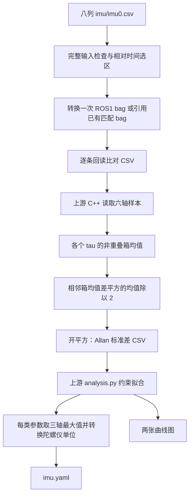

# allan_variance_ros 源码解读：从 IMU 数据到 Kalibr 噪声 YAML

核对日期：2026-09-15。本文依据本机容器 `kalibr-imu-utils-noetic` 内实际安装的 ori-drs/allan_variance_ros，固定提交为 `1d54b602ee7f2ba0427865d63afe4945d913ed24`。检查时上游工作树无修改。本文说明现有实现，不修改计算算法或历史分析结果。

这条链路分成两部分：本项目 Python 脚本负责八列 CSV、时间选择、bag 转换与验证；上游 C++ 从 bag 计算六轴 Allan 标准差，上游 Python 再拟合白噪声和随机游走并写出 `imu.yaml`。YAML 的四个噪声字段面向连续时间模型；生成成功只说明程序产物完整，不能证明拟合区间或噪声模型可靠。

## 1. 源码地图与处理流程

| 文件／函数 | 主要职责 |
|---|---|
| 本项目 `input_format.py` | 完整 CSV 检查、相对首时间戳选区、选段采样率统计 |
| 本项目 `csv_to_rosbag.py` | 八列 CSV → ROS1 sensor_msgs/Imu bag |
| 本项目 `run_allan_variance_ros.py` | 配置上游、复用 bag、执行计算与验证、生成中文报告 |
| 上游 `src/allan_variance.cpp` | 按文件名排序选取第一个 bag，调用计算器 |
| 上游 `AllanVarianceComputor::run()` | 读 topic、按计数抽取、检查时间回退、填充六轴缓冲区 |
| 上游 `AllanVarianceComputor::allanVariance()` | 按样本数分箱、计算相邻箱均值差及 Allan 标准差 |
| 上游 `scripts/analysis.py` | 双对数约束拟合、三轴聚合、绘图、输出 Kalibr YAML |



运行步骤见 [容器与使用说明](docker/ALLAN_VARIANCE_ROS.md)。本项目脚本位于 [allan 目录](../script/imu_utils_docker/allan/)。

## 2. 预处理：哪些是本项目做的

### 2.1 CSV 契约与时间选择

输入表头严格为：

```text
timestamp_ns,wx,wy,wz,ax,ay,az,temperature
```

`input_format.rows()` 将时间戳读成整数纳秒，其他七列读成浮点数；检查列数、数值有限、ROS1 时间范围以及时间戳严格递增。`validate_input()` 先遍历完整源文件，所以选区外的格式或时间错误也会使任务失败。不读取 `meta/session.json` 或 `meta/validation.json`，也不从元数据恢复 frame ID。

设原始 CSV 第一条时间戳为 t₀，选择条件是：

```text
start_ns ≤ timestamp_ns − t₀ < end_ns
```

`--start-h 1 --end-h 23` 即相对 t₀ 的 `[3600,82800)` 秒。不是按文件名解析墙钟时间，也不是截取 bag 第 1–23 小时后再重置时间。秒／小时参数用 Decimal 转换为整数纳秒，目录后缀的一位小数显示不影响真实选区。

选中 N 条消息后，统计实际平均采样率：

```text
f_actual = (N − 1) / (t_last − t_first)     # 时间差以秒计
```

最小、最大采样间隔与源总数写入 `work/run.json`。当前流程只记录采样抖动，并按名义周期近似计算；没有插值或重采样，也没有通过抖动阈值自动判断模型可用性。

### 2.2 转换成 bag 时的映射

| CSV／配置 | ROS1 消息 |
|---|---|
| timestamp_ns | header.stamp，同时作为 bag record time |
| wx、wy、wz | angular_velocity.x/y/z，保持 rad/s |
| ax、ay、az | linear_acceleration.x/y/z，保持 m/s² |
| --frame-id | header.frame_id，默认 imu_link |
| 选段内序号 0…N−1 | header.seq |
| 无姿态数据 | orientation_covariance[0] = -1 |
| temperature | 留在源 CSV，不生成 Temperature topic，不参与 Allan 计算 |

默认使用 LZ4 无损压缩，先写 `work/*.inprogress`，完成后提交顶层 bag。六轴不交换、不变号、不缩放；不做去均值、滤波、去趋势、重力扣除或温度补偿。

之后 `validate_rosbag.py` 全量核对唯一 topic、类型、数量、frame、seq、未知姿态标记、header/record 时间和六轴数值。复用 `--bag` 时仍与选段逐条核对，只建立链接，不复制或重新转换。这里的“数据完整”指 bag 保留 CSV 样本，不等于传感器采集过程中从未漏采。

### 2.3 为什么本流程没有 cookbag

上游 [cookbag.py](https://github.com/ori-drs/allan_variance_ros/blob/1d54b602ee7f2ba0427865d63afe4945d913ed24/scripts/cookbag.py#L20-L27) 重新写 bag，把有 header 的消息 record time 改为 header.stamp；`/tf` 使用第一条 transform 的 stamp，无 header 则保留原 record time。它不修改 IMU 六轴、估计采样率或补偿温度。

本项目转换时已令 record time = header.stamp，且源时间戳严格递增，因此无需再处理一次。本流程也不执行 `rosbag play`；C++ 离线读取 bag。

## 3. 上游读 bag：实际保留了哪些消息

依据 [主入口](https://github.com/ori-drs/allan_variance_ros/blob/1d54b602ee7f2ba0427865d63afe4945d913ed24/src/allan_variance.cpp#L35-L57) 和 [run()](https://github.com/ori-drs/allan_variance_ros/blob/1d54b602ee7f2ba0427865d63afe4945d913ed24/src/AllanVarianceComputor.cpp#L35-L124)。

### 3.1 只处理目录里排序后的第一个 bag

主入口收集 `.bag` 文件，用 `std::set<std::string>` 排序；第一次 `computor.run()` 后直接 break，不会拼接多个 bag。本项目给它单独的 `work/bags/`，里面只有指向目标 bag 的链接。

### 3.2 三个配置参数并不等价

| 配置 | C++ 类型 | 实际作用 |
|---|---|---|
| imu_rate | double | 声明原始采样率，参与抽取步长和按计数限制数据量 |
| measure_rate | int | 声明计算频率，参与抽取步长与各 tau 的箱大小 |
| sequence_time | int | 通过消息计数／imu_rate 限制处理量；并非用真实时间戳截取 |

上游先计算：

```text
imu_skip = int(imu_rate / measure_rate)
```

读取配置 topic 下的 sensor_msgs/Imu，每遇到一条先令 counter 加一；下列任一成立就跳过：

```text
counter % imu_skip != 0
counter / imu_rate > sequence_time
```

因此 `imu_skip=2` 保留第 2、4、6…条；这是直接抽取，不是先低通再降采样。频率比的整数截断也不保证保留后的真实频率等于 measure_rate。若配置导致 skip=0，会出现取模零的问题，上游没有完善的参数防护。

当前包装脚本设置 `imu_rate=f_actual`、`measure_rate=floor(f_actual)`，并要求 `int(imu_rate/measure_rate)=1`；`sequence_time=ceil(N/f_actual)+1`。这样保留本次选段的所有消息，时间选区由 CSV 阶段完成。

### 3.3 时间戳只用于读取顺序检查，不用于分箱

上游对保留下来的消息比较 header.stamp：小于上一条则报 `IMU out of order` 并跳过；相等不会被此条件拒绝。项目输入检查更严格，相等也失败。

上游把时间戳和六轴放进内存 `imuBuffer_`，但后续分箱只访问数组索引与六轴。不会按真实 dt 加权，不修复时间缺口；消息姿态、协方差和 frame ID 不参与计算，也不执行坐标变换。

固定零偏／固定重力分量会在相邻箱均值相减时抵消，因此没有先减常数的步骤并不奇怪。但姿态变化导致的重力投影变化、温漂和真实运动不会自动抵消，仍会进入结果。

## 4. Allan 方差怎样计算

依据 [allanVariance()](https://github.com/ori-drs/allan_variance_ros/blob/1d54b602ee7f2ba0427865d63afe4945d913ed24/src/AllanVarianceComputor.cpp#L129-L233)。以下对任意单轴 xᵢ 说明，六轴各自独立计算。

### 4.1 tau 网格与箱大小

```text
period = 1, 2, …, 9999
tau = period × 0.1 秒
m = int(tau × measure_rate)
```

默认得到 0.1–999.9 秒的 9,999 个 tau，线性步长 0.1 秒，不是对数均匀采点。m 由浮点乘积截断为整数；复算时应复制这个行为，不能随意改为 round。低采样率可能令 m=0，短数据可能不足两个箱；上游没有为这些情况自动缩短 tau 范围。

构造函数把 `overlap_` 固定为 0.0，没有配置读取覆盖。因此尽管源码注释写着 “Overlapping method”，**当前实际是非重叠分箱**，箱起点每次增加 m，不是每次滑动一个样本。

### 4.2 一个需要注意的边界细节

源码起点循环等价于：

```text
j = 0
while j < N − m:
    使用 x[j : j+m]
    j += m
```

当 N≥m 且 m>0 时，箱数为：

```text
K = floor((N − 1) / m)
```

如果 N 恰好被 m 整除，会比通常 `floor(N/m)` 的写法少一个完整末箱。例如 N=1000、m=100，实际只用 9 个箱，不是 10 个。末尾不足 m 的样本也不参与该 tau 的计算。

所以“上游读入全部 N 条”不代表每个 tau 都使用 N 条。不同 tau 的尾部舍弃是此实现的分箱行为。项目独立复算使用相同边界，避免把实现差异误判成计算错误。

### 4.3 箱均值、方差与标准差

先对每个不重叠箱求均值：

$$
\bar{x}_k=\frac{1}{m}\sum_{i=0}^{m-1}x_{km+i},\qquad k=0,\ldots,K-1
$$

再算相邻箱均值差的平方：

$$
\sigma_A^2(\tau)=\frac{1}{2(K-1)}\sum_{k=0}^{K-2}(\bar{x}_{k+1}-\bar{x}_k)^2
$$

最后开平方：

$$
\sigma_A(\tau)=\sqrt{\sigma_A^2(\tau)}
$$

这是 Allan 方差，不是“原始样本减总均值”的普通方差。白噪声在**标准差图**上为 −1/2 斜率，偏置随机游走为 +1/2；在方差图上相应为 −1、+1，不能混用。

程序直接处理角速度和加速度，不先积分成角度或速度。计算箱均值时将陀螺仪由 rad/s 乘 180/π 转为 deg/s，加速度计保持 m/s²。

### 4.4 输出文件与数值精度

虽名为 `allan_variance.csv`，实际调用 `writeAllanDeviation()`，保存的是开平方后的**标准差**。格式为空格分隔、无表头，顺序是：

```text
tau acc_x_AD acc_y_AD acc_z_AD gyr_x_AD gyr_y_AD gyr_z_AD
```

tau 使用 19 位有效数字，六轴使用 7 位有效数字，而非 7 位小数；因此可能看到 `999.9000000000001`。Python 拟合读取的是这个已舍入的文本文件，而不是内存中的未舍入方差。[输出结构实现](https://github.com/ori-drs/allan_variance_ros/blob/1d54b602ee7f2ba0427865d63afe4945d913ed24/include/allan_variance_ros/AllanVarianceComputor.hpp#L43-L55)。

计算各 tau 的箱均值使用 OpenMP，并把所有尺度的均值保存在 map，最后按 tau 顺序计算及输出。没有使用前缀和；时间开销近似随 N×tau 数量增长。日志 `Total computation time` 使用 `std::clock()`，是进程 CPU 时间，包含该计时范围内的读入和计算，不能直接当成墙钟等待时间，尤其多线程时。

## 5. 从曲线拟合两个噪声系数

依据 [analysis.py 的拟合函数](https://github.com/ori-drs/allan_variance_ros/blob/1d54b602ee7f2ba0427865d63afe4945d913ed24/scripts/analysis.py#L17-L51) 和 [参数提取](https://github.com/ori-drs/allan_variance_ros/blob/1d54b602ee7f2ba0427865d63afe4945d913ed24/scripts/analysis.py#L122-L170)。

### 5.1 真正的拟合目标

`get_intercept()` 对 tau 和 AD 取自然对数，调用 SciPy curve_fit：

$$
\min_{s,c}\sum_i[\ln\sigma_A(\tau_i)-(s\ln\tau_i+c)]^2,
\qquad s\in[s_0,s_0+0.001]
$$

得到的线是 `AD_fit(tau)=exp(c)×tau^s`。每个输入点等权，不按箱数、置信度或对数区间加权；拟合返回的协方差矩阵被丢弃，没有据此做参数验收。

函数最后一个参数虽叫 b，实际是“在哪个 tau 求拟合值”，不是拟合直线的截距。传 1.0 或 3.0 分别表示在 1 秒或 3 秒取值。源码注释中的 `y=-0.5*x+1.0` / `y=0.5*x+3.0` 不能当成实际拟合公式。

### 5.2 白噪声：紫线与圆点

实际输入是 `period[:white_noise_break_point]`，break point 为 tau=10 的索引：默认即 **0.1–9.9 秒，共 99 点**。斜率限制为 `[-0.5,-0.499]`，取拟合线在 tau=1 秒的值，记为 Nw。

白噪声理论项为：

$$
\sigma_{A,white}(\tau)=\frac{N_w}{\sqrt{\tau}}
$$

因此按秒为时间单位时，1 秒处数值给出白噪声系数。圆点是拟合线取值，不是简单读取实测 AD(1s)。上游日志称陀螺仪为 Angle Random Walk、加速度计为 Velocity Random Walk；这两者在此指白噪声系数，不能因为名称带 Random Walk 就映射到 YAML 的偏置随机游走字段。

### 5.3 偏置随机游走：黄线与五角星

实际传入的是 **所有 period、所有 AD**，默认 9,999 点，斜率限制为 `[0.5,0.501]`。取拟合线在 tau=3 秒的值，记为 Kb。

对应模型为：

$$
\sigma_{A,walk}(\tau)=K_b\sqrt{\tau/3}
$$

所以在 3 秒取值。五角星通常位于整条实测曲线下面，它表示分量模型的外推取值，而不是某条 3 秒实测样本。

变量 `random_rate_break_point` 虽被设为 tau=10 的索引，但后面没有用于切片。当前实现**不是只拟合 tau>10 的段，更没有检测实测斜率后选择 +1/2 段**。线性 tau 网格下，长 tau 区间占据绝大多数点；不同点又共享同一份原始数据，因此不能把 9,999 个点当作相互独立、等可信的观测。

### 5.4 Bias Instability：三角形及 0.664 系数

三角形直接使用各轴 `min(AD)` 与对应的 argmin(tau)，上游日志称其为 Bias Instability。没有平台识别、平滑、局部斜率检查或不确定度评估；最低点可能受有限样本波动影响。

它不写入四个 Kalibr 噪声字段。还要区分“实测最低 AD”与模型中的闪烁偏置系数 B：`generate_prediction()` 的常数方差项是 `2 ln(2)/π × B²`，对应 AD 为约 `0.664×B`。若一个平台确实由该过程主导，按此模型应有 `B≈平台AD/0.664`。

但当前代码把实测最低 AD 直接作为 q_bias_instability 传给模型，并没有除以 0.664。这是黑线实现中的归一化细节，不能把三角形、严格定义的 B 和 Kalibr Kb 当成同一个量；本文不据此修改已有参数。

## 6. Kalibr YAML 的字段、单位与聚合

每轴先分别得到 Nw 与 Kb。随后各类别在 X/Y/Z 中取最大值；加速度计两项直接写出，陀螺仪两项再乘 π/180。不是三轴平均，也不是平方和开根号。[加速度计写出](https://github.com/ori-drs/allan_variance_ros/blob/1d54b602ee7f2ba0427865d63afe4945d913ed24/scripts/analysis.py#L144-L152)，[陀螺仪写出](https://github.com/ori-drs/allan_variance_ros/blob/1d54b602ee7f2ba0427865d63afe4945d913ed24/scripts/analysis.py#L236-L244)。

| YAML 字段 | 取值来源 | 连续时间系数单位 |
|---|---|---|
| accelerometer_noise_density | max(Nw_acc_xyz) | (m/s²)/√Hz，等价 m/s^1.5 |
| gyroscope_noise_density | max(Nw_gyr_xyz) × π/180 | (rad/s)/√Hz，等价 rad/√s |
| accelerometer_random_walk | max(Kb_acc_xyz) | (m/s²)/√s，等价 m/s^2.5 |
| gyroscope_random_walk | max(Kb_gyr_xyz) × π/180 | (rad/s)/√s，等价 rad/s^1.5 |
| rostopic | config 的 imu_topic | topic 字符串 |
| update_rate | config 的 imu_rate | Hz；不是 measure_rate |

Kalibr 的 noise_density 指连续白噪声强度，random_walk 指驱动偏置变化的连续白噪声强度。按其模型，给定 Δt 后，单样本白噪声标准差为 `Nw/√Δt`，相邻采样偏置增量标准差为 `Kb×√Δt`；后者不是偏置本身的长期标准差。以上离散化关系依赖相应噪声及带宽模型，不能对简单抽取后的数据机械套用。当前 analysis.py 写 YAML 时没有乘或除 √采样率，应保留连续参数。[Kalibr 官方噪声模型](https://github.com/ethz-asl/kalibr/wiki/IMU-Noise-Model)。

没有提供 config 时，脚本默认 `/sensors/imu`、400 Hz；本项目始终传 config。上游没有自动校正与传感器带宽相关的 PSD 约定，也没有执行 Kalibr 标定。

## 7. 图像中的黑线和标记

| 图中元素 | 实际代码含义 |
|---|---|
| 红／绿／蓝曲线 | X／Y／Z 实测 Allan 标准差 |
| 三条紫线 | 各轴约 −1/2 斜率拟合线 |
| 三条黄线 | 各轴约 +1/2 斜率拟合线 |
| 圆点 | 紫线 tau=1 秒的 Nw 取值 |
| 五角星 | 黄线 tau=3 秒的 Kb 取值 |
| 三角形 | 各轴实测曲线最低点 |
| 单条黑线 | 使用三轴平均参数合成的模型 |

黑线公式为：

$$
\sigma_{model}(\tau)=\sqrt{3Q^2/\tau^2+\bar{N}_w^2/\tau+
(2\ln2/\pi)\bar{B}^2+\bar{K}_b^2\tau/3+R^2\tau^2/2}
$$

实际调用时 Q=R=0；Nw、最低 AD、Kb 分别取三轴算术平均。**没有再做一次五项联合拟合**。所以图例虽写 fitted model，黑线既不是逐轴最优模型，也不是最终 YAML 的最大轴模型。左图单位是 deg/s，右图是 m/s²，纵轴是标准差；横轴是平均窗口长度，不是录制经过时间。

## 8. 本次 1–23 小时数据实例

原始输入 `imu_260911_1502/imu/imu0.csv`，选段 `[1h,23h)`。运行记录和原图见 [本次报告](../data/allan_variance/imu_utils_output/imu_260911_1502_1h-23h_allan_variance_ros/allan_variance_ros_report.md)。

| 项目 | 本次值 |
|---|---:|
| 原始 CSV 消息数 | 8,975,866 |
| 选段／上游读入数 | 7,962,378 |
| 首末时间差 | 79,199.982496933 s |
| 实际平均采样率 | 100.53508534939816 Hz |
| 最小／最大 dt | 4.959667 / 14.944750 ms |
| measure_rate | 100 Hz |
| imu_skip | 1 |
| sequence_time | 79201 s |
| 每轴曲线点数 | 9,999 |

tau=999.9 秒时 m=99,990，得到 K=79 个箱、78 对相邻均值差。按实际平均采样率估算，该箱时长约为 994.5782 秒，而图上标注 999.9 秒。即名义时间尺度约比这个平均时间尺度大 0.535%；此外还有局部采样抖动。此处只是解释现有近似，未重新标定横轴或修正结果。

从已有 `work/allan_variance.csv` 独立重算拟合，得到：

| 轴 | 圆点 Nw | 星形 Kb | 最低 AD | 最低点 tau/s |
|---|---:|---:|---:|---:|
| acc X | 0.00531888344 | 3.43565327e-5 | 2.888175e-4 | 809.3 |
| acc Y | 0.00971509841 | 5.20758495e-5 | 3.577923e-4 | 793.1 |
| acc Z | 0.01080704722 | 5.34012436e-5 | 3.343937e-4 | 964.8 |
| gyr X | 0.01328197211 | 8.43463121e-5 | 7.046061e-4 | 669.6 |
| gyr Y | 0.01841080623 | 1.74959449e-4 | 1.567647e-3 | 711.7 |
| gyr Z | 0.01573782908 | 1.02426105e-4 | 7.717472e-4 | 844.2 |

表中加速度计 Nw 单位 m/s^1.5、Kb 单位 m/s^2.5、最低 AD 单位 m/s²；陀螺仪三列分别为 deg/√s、(deg/s)/√s、deg/s。数值按源码的 tau 取值约定解释。

本次四个 YAML 噪声参数由上述三轴聚合独立复现，与文件一致（相对容差 1e-12）：

```yaml
accelerometer_noise_density: 0.010807047217824264
accelerometer_random_walk: 5.340124363989863e-05
gyroscope_noise_density: 0.00032132918657711045
gyroscope_random_walk: 3.0536184482239376e-06
rostopic: /imu/data
update_rate: 100.53508534939816
```

本次六轴的随机游走拟合斜率均贴近允许的下界 0.5。因为该斜率是强约束，不能据此说数据“检测到了 0.5 斜率”。结合实测曲线在大 tau 端主要下降或趋平，只能把这些 Kb 视为原版算法输出的候选值。


## 9. 验证通过究竟证明了什么

| 检查 | 执行位置 | 能证明什么 |
|---|---|---|
| CSV 列、时间与有限值 | 本项目 input_format.py | 输入可解析、时间严格递增 |
| bag 全量逐条比对 | 本项目 validate_rosbag.py | 转换／引用与选中 CSV 一致 |
| 上游读入计数 | 本项目解析 computation.log | 读入数一致，未因配置或时间回退丢消息 |
| 曲线 9999×7、正值、有限、tau 网格 | 本项目 check_curves() | 数值产物结构符合预期 |
| 五尺度六轴独立复算 | 本项目 check_curves() | 与该版本的非重叠分箱公式一致；不是全尺度独立复算 |
| 四参数正值、topic/rate、图像存在 | 本项目运行入口 | 产物完整，格式可供后续使用 |
| 四个 YAML 参数独立复现 | 本文解读时额外检查 | 现有曲线经拟合、聚合及单位转换可复现 YAML |

五个复算尺度为 0.1、1、10、100、999.9 秒，比较容差考虑文本输出只有 7 位有效数字。当前验证没有自动验收静止性、恒温条件、拟合段可信度、噪声参数置信区间、三轴相关性或实际 Kalibr 标定误差。

读取日志时还要注意：上游某些异常会被捕获后继续运行，或只打印错误；不能仅看进程返回 0。项目包装脚本进一步检查消息数和输出，正是为避免将这类情况当作成功。

## 10. 维护时优先核对的源码位置

以下链接固定提交，避免上游 main 更新导致本文行号失效：

- [bag 文件选择与 CPU 计时：allan_variance.cpp](https://github.com/ori-drs/allan_variance_ros/blob/1d54b602ee7f2ba0427865d63afe4945d913ed24/src/allan_variance.cpp#L19-L62)
- [配置、抽取与时间检查：AllanVarianceComputor.cpp](https://github.com/ori-drs/allan_variance_ros/blob/1d54b602ee7f2ba0427865d63afe4945d913ed24/src/AllanVarianceComputor.cpp#L12-L124)
- [箱边界、陀螺仪单位、方差及开方](https://github.com/ori-drs/allan_variance_ros/blob/1d54b602ee7f2ba0427865d63afe4945d913ed24/src/AllanVarianceComputor.cpp#L129-L246)
- [拟合函数与五项预测公式：analysis.py](https://github.com/ori-drs/allan_variance_ros/blob/1d54b602ee7f2ba0427865d63afe4945d913ed24/scripts/analysis.py#L17-L80)
- [白噪声与随机游走拟合窗口](https://github.com/ori-drs/allan_variance_ros/blob/1d54b602ee7f2ba0427865d63afe4945d913ed24/scripts/analysis.py#L122-L146)
- [陀螺仪聚合、YAML 与绘图](https://github.com/ori-drs/allan_variance_ros/blob/1d54b602ee7f2ba0427865d63afe4945d913ed24/scripts/analysis.py#L219-L317)

以后升级版本，应重新核对以上行为，尤其 overlap、分箱循环的 `<` 边界、随机游走拟合输入范围、最低值的归一化，以及 YAML 的单位和三轴聚合方式。
